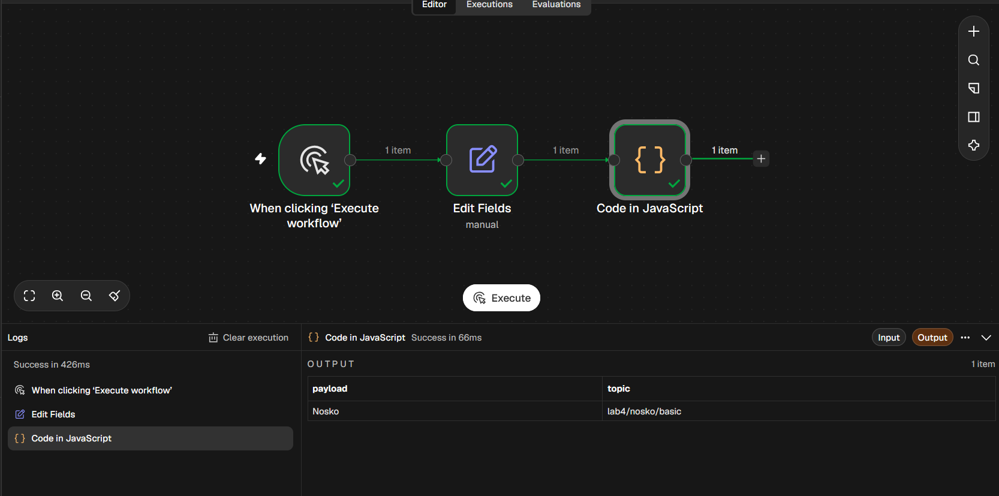
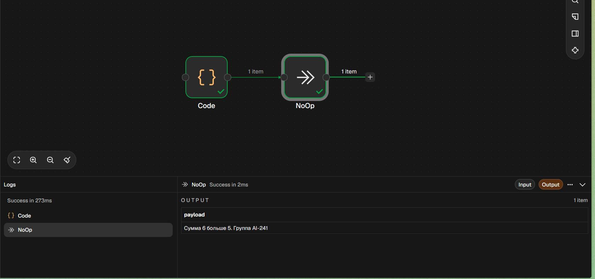
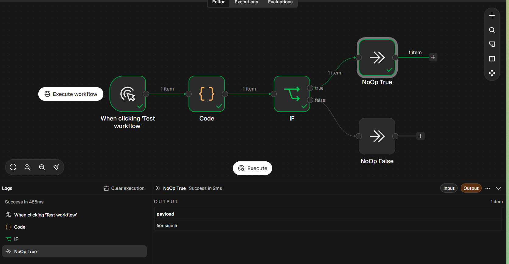
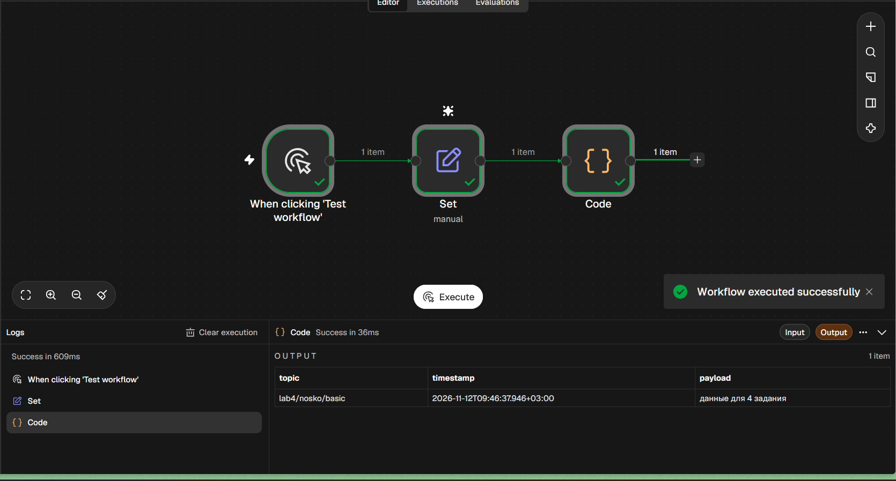
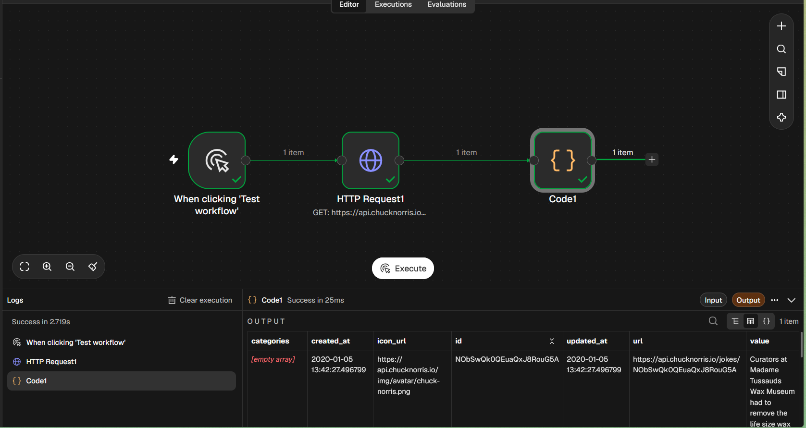
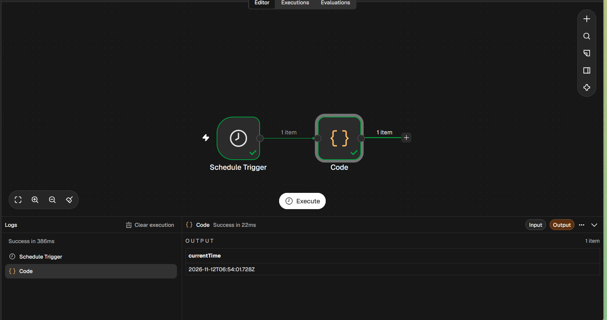
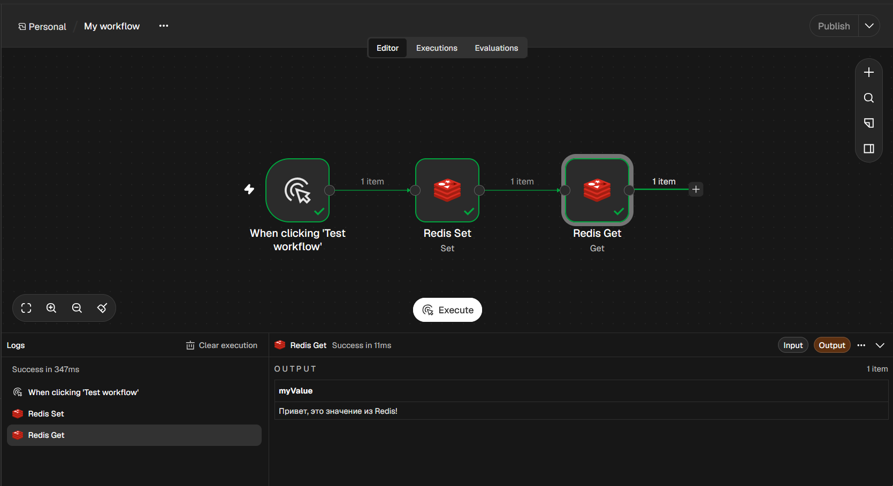
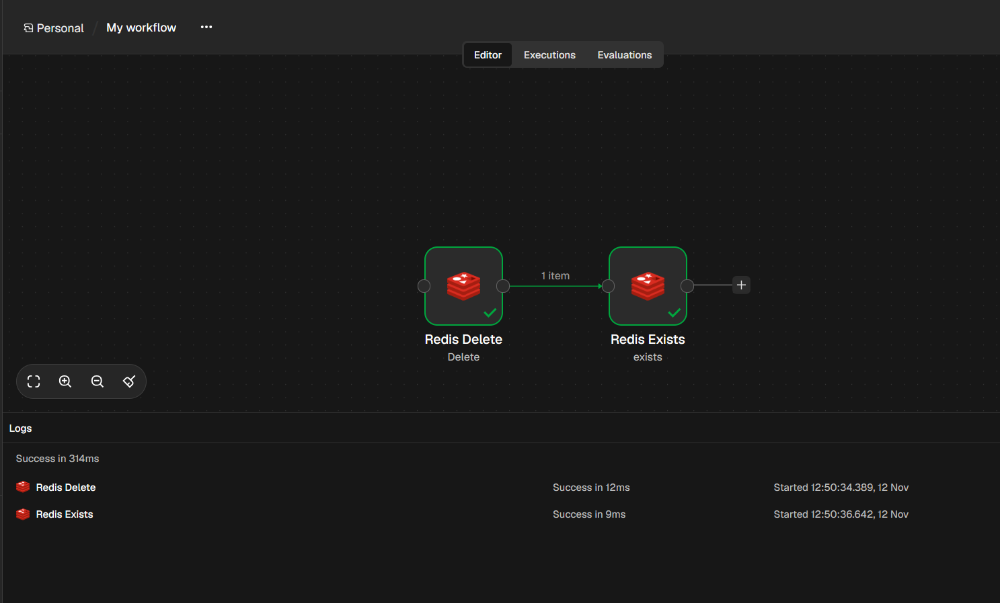

# Лабораторная работа №4. n8n

**Выполнила:** студентка группы ИИ-241, Носко Анастасия

## 1. Установка n8n
n8n был запущен локально через Docker. Использована команда `docker run` с пробросом порта `5678` и volumes для сохранения данных (папки `/home/node/.n8n` и `/data`).
*(Примечание: скриншот версии и контейнеров добавь сюда, если он у тебя есть. Если нет — просто удали эту строчку)*

## 2. Освоенные ноды
В ходе работы были изучены и применены следующие ноды:
- **Manual Trigger** — ручной запуск.
- **Schedule Trigger** — запуск по расписанию.
- **Set (Edit Fields)** — создание и изменение полей (payload, topic).
- **Code** — написание JavaScript-кода (работа с объектами, массивами, циклами, if/else).
- **IF** — ветвление логики.
- **HTTP Request** — выполнение GET-запросов к внешнему API.
- **Redis** — создание, чтение, удаление ключей.
- **NoOp** — пустая нода для завершения веток.

## 3. Скриншоты воркфлоу (Часть 2)

**2.1. Manual Trigger → Set → Code**

**2.2. Manual Trigger → Code → NoOp**

**2.3. Manual Trigger → Code → IF → (true) NoOp / (false) NoOp**

**2.4. Set (изменение полей)**

**2.5. HTTP Request (запрос к API)**

**2.6. Schedule Trigger**

## 4. Скриншоты воркфлоу (Часть 3: Redis)

**Создание и чтение ключа (flow-09)**

**Удаление и проверка отсутствия (flow-10)**

## 5. Использованные AI-промпты
В ходе выполнения работы использовались следующие запросы к ИИ:
- "Как запустить n8n в Docker с двумя volume?"
- "Ошибка invalid reference format в docker run, как исправить?"
- "Напиши пример JS-кода для ноды Code в n8n с циклом и условием"
- "Как соединить контейнеры n8n и Redis в Docker?"
- "Как настроить credential для Redis в n8n, если контейнеры в одной сети?"

## 6. Выводы
В ходе лабораторной работы я научилась разворачивать n8n через Docker, изучила основные и продвинутые ноды (Code, IF, HTTP Request), а также настроила связку с Redis для хранения данных. Поняла, как работают расписания (Schedule Trigger) и как связывать n8n с другими сервисами (на примере Redis). Возникшие сложности с сетью Docker были успешно решены созданием общей сети `lab-net`.