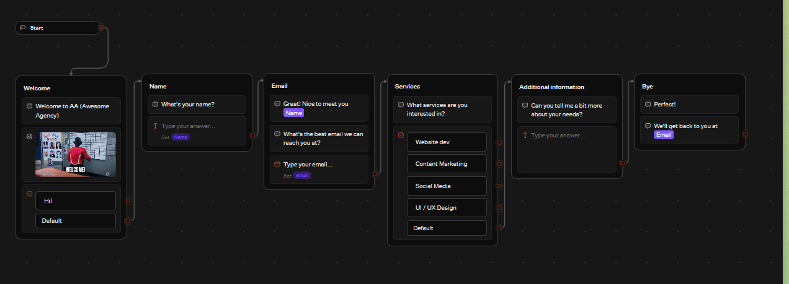
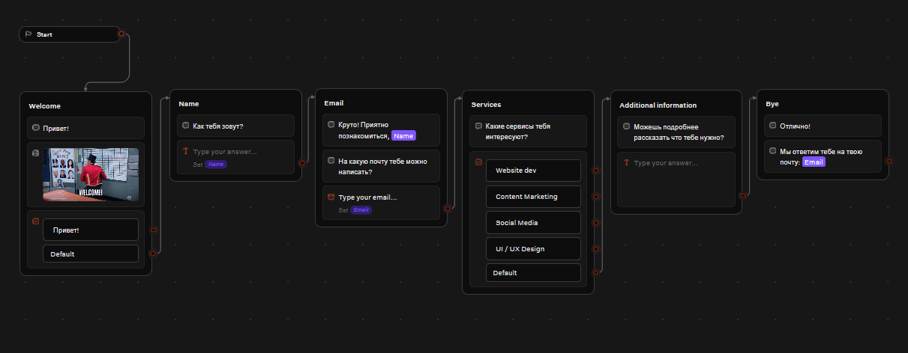
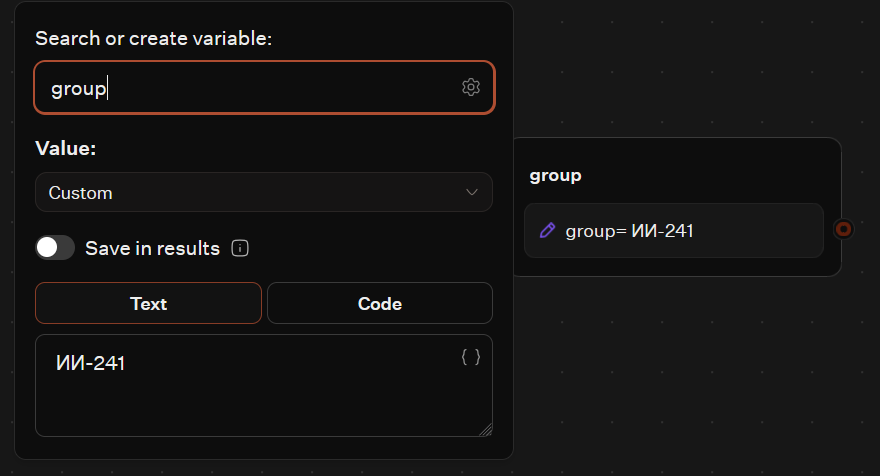
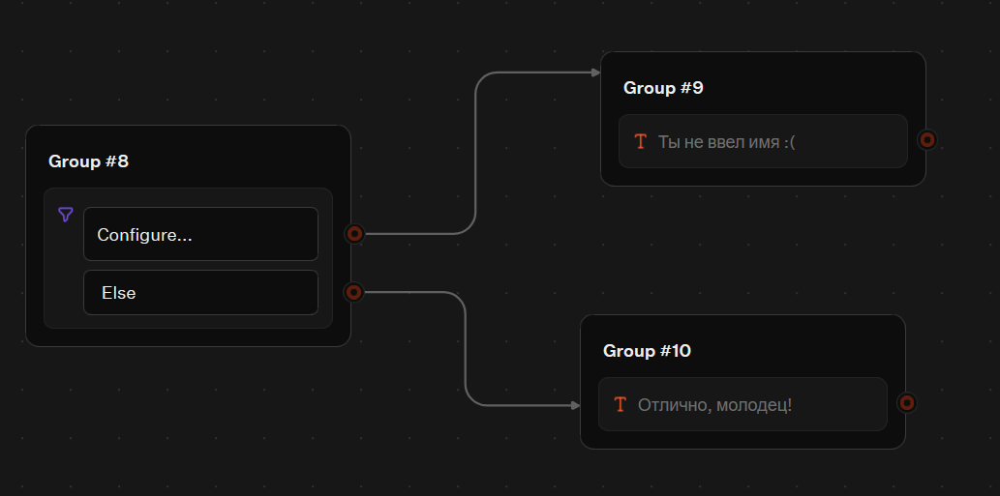
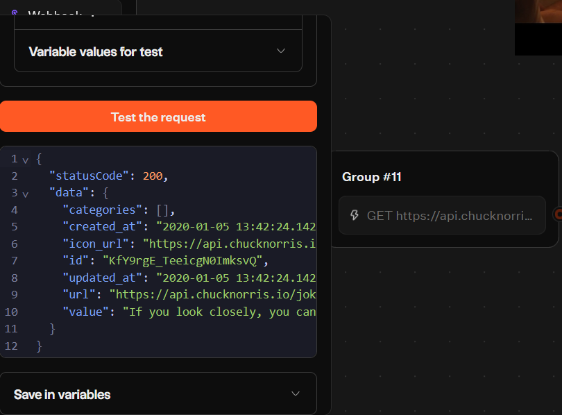
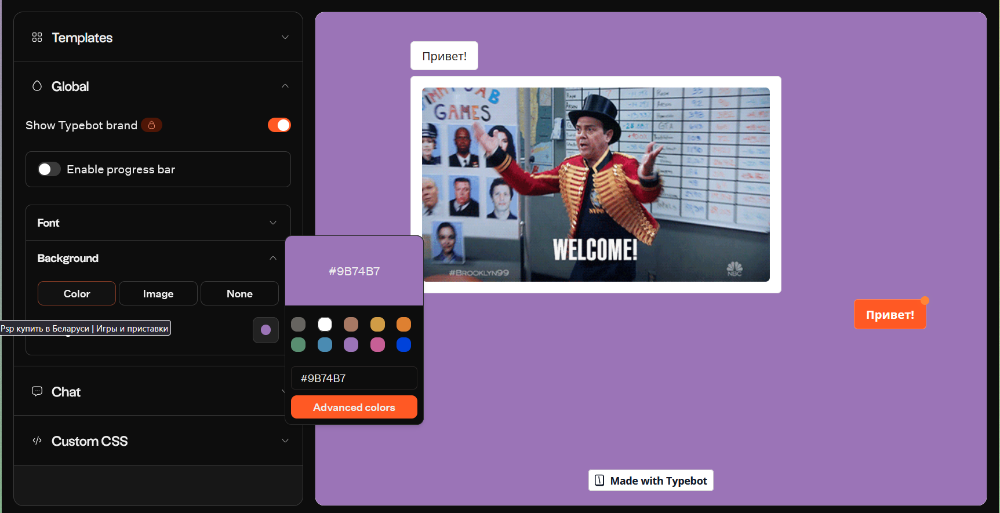
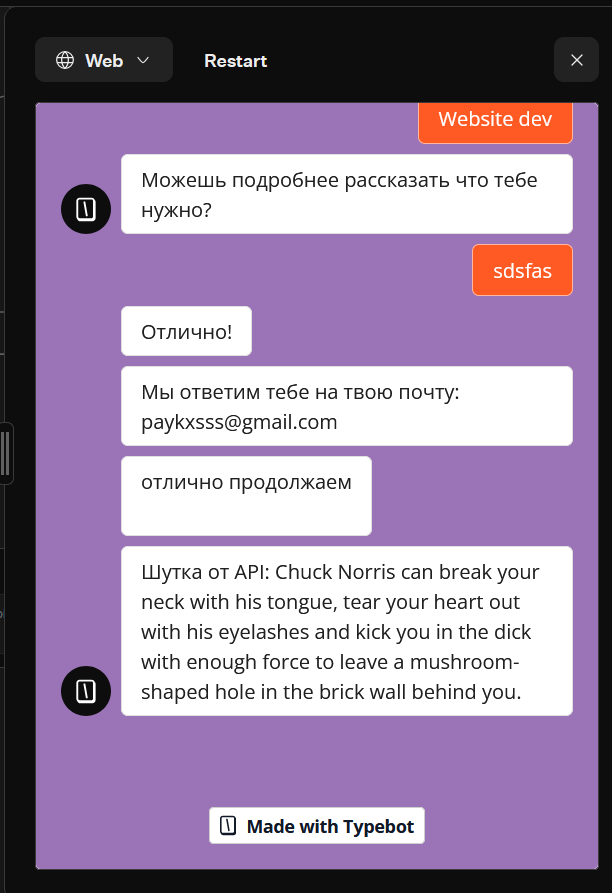

# Лабораторная работа №5. Чат-боты

**Выполнила:** студентка группы ИИ-241, Носко Анастасия
**Трек:** C (TypeBot)

## 1. Ссылка на бота
https://typebot.co/lead-generation-wdpurwg

## 2. Внесенные изменения (по заданию)
1. Выбран шаблон "Lead Generation" из библиотеки Templates.
2. Весь текст шаблона переведен на русский язык.
3. Добавлено 2 новых блока: текст с приветствием и картинка.
4. Добавлено условие (Condition), проверяющее, ввел ли пользователь имя.
5. Добавлена переменная `group` (со значением WI-241).
6. Добавлена интеграция HTTP Request (запрос к API с шутками Чака Норриса). Ответ сохранен в переменную `joke`.
7. Изменена тема бота: установлен кастомный цвет и аватарка.
8. Опубликован в Web (или Telegram) и экспортирован в JSON.

## 3. Скриншоты

**Выбор шаблона:**

**Общий вид холста (До/После):**

**Настройка переменной:**

**Настройка условия:**

**Настройка HTTP-запроса:**

**Смена темы:**

**Результат работы бота (шутка из API):**

## 4. Использованные AI-промпты
- "Как перевести шаблон в TypeBot?"
- "Как настроить HTTP Request в TypeBot для вывода шутки?"
- "Как создать Condition в TypeBot?"
- "Где скачать JSON экспорт бота в TypeBot?"

## 5. Выводы
В ходе работы я освоила визуальный конструктор TypeBot. Научилась работать с шаблонами, переменными, условиями и внешними API (HTTP Request). Поняла, как публиковать ботов в Web и Telegram, а также как экспортировать проект в JSON.