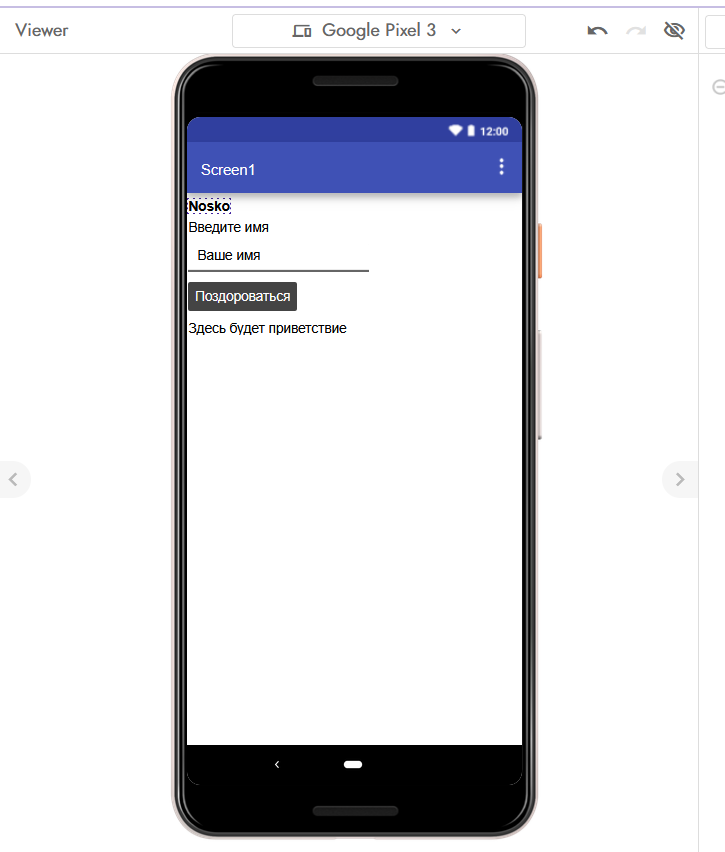
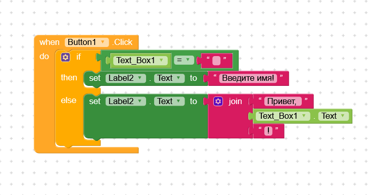

# Лабораторная работа №6. Kodular

**Выполнила:** студентка группы ИИ-241, Носко Анастасия
**Название проекта:** lab6-nosko-hello

## 1. Краткое описание приложения
Создано простое мобильное приложение «Приветствие». На главном экране (Screen1) расположены: заголовок «Введите имя», текстовое поле для ввода имени (с подсказкой «Ваше имя»), кнопка «Поздороваться» и нижний Label для вывода результата. В нижней части экрана размещен Label с фамилией автора на английском языке (Nosko) для подтверждения авторства.

Логика приложения: при нажатии на кнопку проверяется, пустое ли текстовое поле. Если пустое — выводится сообщение «Введите имя!». Если введено имя — выводится приветствие «Привет, <имя>!» с использованием блока соединения строк (join).

## 2. Ссылка на проект
Проект экспортирован в файл `lab6-nosko.aia` и находится в папке `exports/`.

## 3. Использованные AI-промпты
- "Как в Kodular сделать так, чтобы при нажатии на кнопку проверялось, пустое ли текстовое поле, и выводилось сообщение?"
- "Как использовать блок join в Kodular для соединения строк?"
- "Как соединить блоки if и then в Kodular?"

## 4. Освоенные компоненты и блоки
**Компоненты (Designer):**
- Label (заголовок и вывод результата)
- TextBox (поле ввода)
- Button (кнопка действия)

**Блоки (Blocks):**
- `when Button.Click do` (событие нажатия)
- `if then else` (условие)
- Логическое `=` (сравнение)
- `TextBox.Text` (получение текста)
- `set Label.Text to` (установка текста)
- `join` (соединение строк)

## 5. Скриншоты

**Экран дизайнера (Screen1):**

**Блоки логики:**

## 6. Ограничения бесплатного тарифа
В ходе работы использовался бесплатный тариф Kodular. Ограничения: до 10 проектов одновременно, до 10 МБ ассетов (картинок/файлов), до 5 расширений (extensions). Для базового приложения этих лимитов более чем достаточно.

## 7. Выводы
В ходе лабораторной работы я освоила визуальную среду разработки Kodular. Научилась создавать пользовательский интерфейс (добавлять кнопки, текстовые поля и метки) и прописывать базовую логику с помощью блоков (условия, проверка на пустоту, соединение строк). Приложение успешно экспортировано в формат `.aia`.