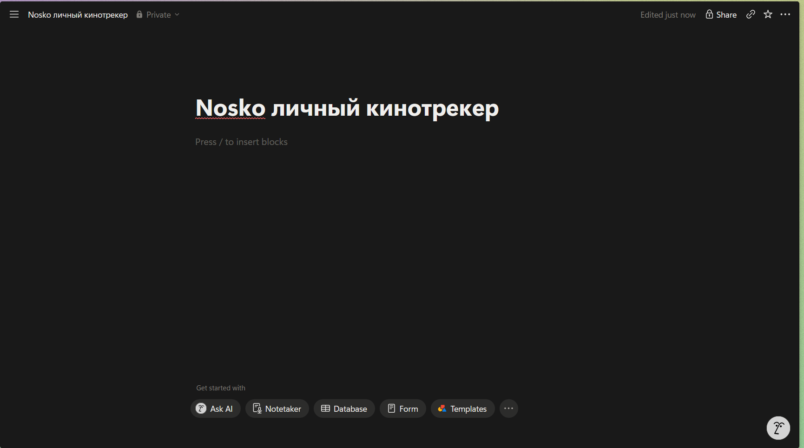
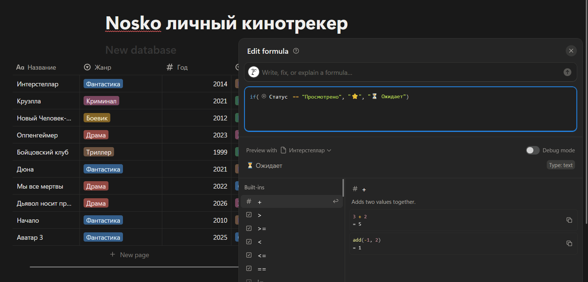
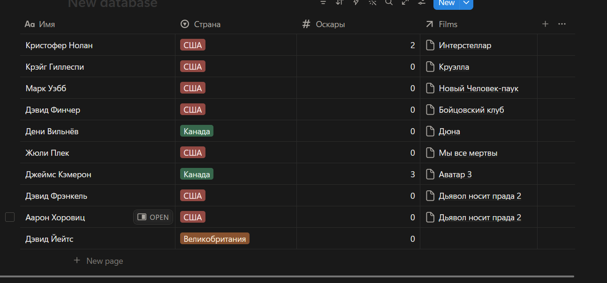
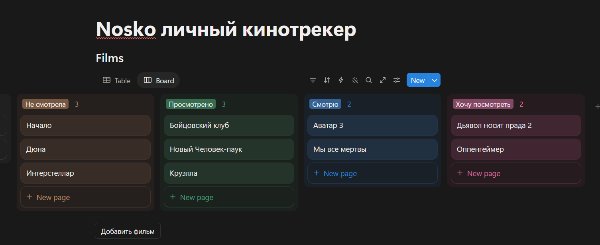

# Лабораторная работа №7. Notion

**Выполнила:** студентка группы ИИ-241, Носко Анастасия
**Название проекта:** Nosko Workspace

## 1. Сгенерированная модель данных
**Промпт для ИИ:** «Придумай уникальную предметную область для учебного проекта в Notion (трекер фильмов). Нужно 3–4 связанные сущности, минимум 2 связи Relation, свойства типов Title, Select, Date, Number, Formula. Опиши модель данных».

**Схема:**
Тема: Учет личного кинотрекера.
1. **Фильмы (Movies)** — Title (Название), Select (Жанр, Статус), Number (Год), Date (Дата просмотра), Formula (Рейтинг).
2. **Режиссеры (Directors)** — Title (Имя), Select (Страна), Number (Оскары).
3. **Отзывы (Reviews)** — Title (Заголовок), Text (Текст), Number (Оценка).

**Связи (Relations):**
- Фильмы ↔ Режиссеры (Один режиссер — много фильмов).
- Фильмы ↔ Отзывы (Один фильм — много отзывов).

**Что исправлено после проверки:** Добавила тип Formula для автоматического вывода звездочек в зависимости от статуса. Разделила сущности на 3 отдельные базы для нормализации данных.

## 2. Ссылка на проект
(https://paykxsss.notion.site/Nosko-419b710ba79a80dba812f94010fde34d?source=copy_link)
Проект также экспортирован в файл `lab7-nosko.md` (папка `exports/`).

## 3. Освоенные компоненты и настройки
- **Базы данных (Databases)** — создание таблиц с нуля.
- **Свойства (Properties)** — Title, Text, Select, Number, Date, Formula, Relation.
- **Связи (Relations)** — связывание баз данных между собой (Фильмы-Режиссеры, Фильмы-Отзывы).
- **Формулы (Formula)** — написание вычислений с `if`.
- **Представления (Views)** — работа с таблицей и Канбан-доской.
- **Кнопки (Buttons)** — создание кнопок для автоматического добавления записей.

## 4. Скриншоты
**Главная страница:**

**Формула:**

**Связи (Relations):**

**Представления и кнопка:**

## 5. Ограничения бесплатного тарифа
В бесплатном тарифе Notion ограничено количество загружаемых файлов (до 5 МБ на файл) и нет полной истории версий страниц (доступна только история за 7 дней).

## 6. Выводы
В ходе лабораторной работы я освоила базовые и продвинутые возможности Notion для создания баз данных. Научилась генерировать модели данных с помощью ИИ и реализовывать их в виде связанных таблиц с формулами, представлениями и кнопками.